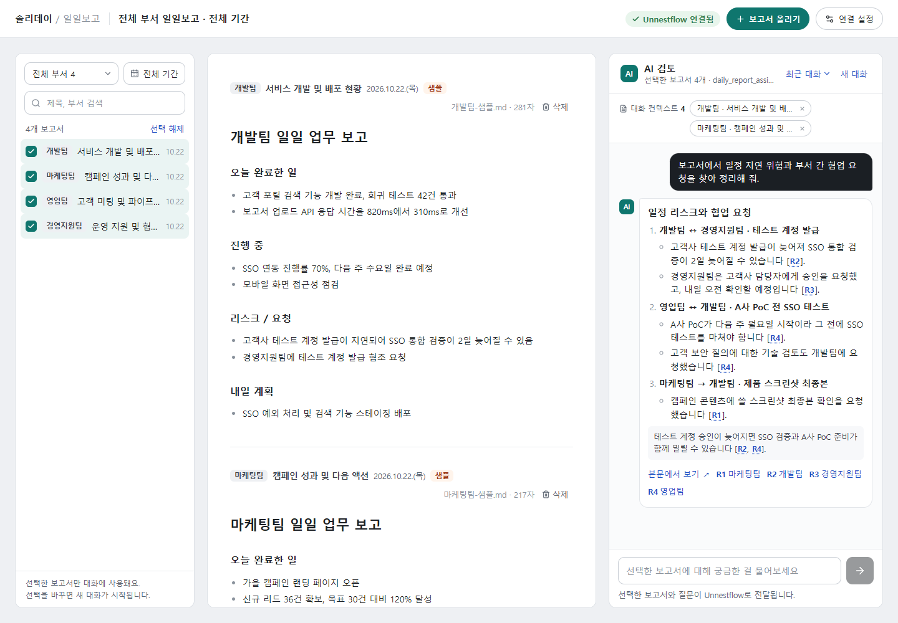

# Daylog

부서별 Markdown 업무 보고서를 모으고, 선택한 자료에 대해 질문하는 웹 애플리케이션입니다. React 화면과 Node.js API 서버를 **하나의 컨테이너**로 빌드합니다. 보고서와 대화는 SQLite에 저장하고, 답변은 외부 Unnestflow의 Flow를 MCP로 호출해 생성합니다.



## 빠른 시작

Docker Engine 또는 Docker Desktop과 Docker Compose v2가 필요합니다. 소스 빌드에 로컬 Node.js나 Unnestflow 소스는 필요하지 않습니다.

```bash
git clone https://github.com/unnest-kr/daylog.git
cd daylog
docker compose up -d --build
```

**http://127.0.0.1:3090** 에서 엽니다. 최초에는 빈 워크스페이스이며, 보고서를 직접 올리거나 표시가 있는 샘플 보고서 4개로 시작할 수 있습니다. MCP 연결 없이도 업로드·조회·필터·삭제를 사용할 수 있습니다. 채팅 답변에는 별도로 연결한 Unnestflow와 모델이 필요합니다.

기본 포트가 사용 중이면 다음처럼 다른 포트를 지정합니다.

```bash
DAYLOG_PORT=3091 docker compose up -d --build
```

이 경우 http://127.0.0.1:3091 로 접속합니다. Windows PowerShell에서는 `.env`의 `DAYLOG_PORT=3091` 설정을 사용하면 됩니다. 기본 공개 범위는 호스트의 loopback 주소입니다.

컨테이너 이미지만 빌드하고 실행할 수도 있습니다.

```bash
docker build -t daylog:local .
docker run -d --name daylog \
  -p 127.0.0.1:3090:3090 \
  -v daylog-data:/data \
  daylog:local
```

Compose와 직접 실행 방식 중 하나를 선택합니다. 두 방식의 볼륨 이름은 다르므로 같은 데이터를 공유하려면 동일한 볼륨을 지정해야 합니다.

## Unnestflow 연결

Daylog는 Unnestflow 서버·Flow·모델을 자동으로 설치하거나 생성하지 않습니다. 실행 중인 Unnestflow에서 다음을 준비합니다.

1. `Chat Input → 모델 → Chat Output` Flow를 만듭니다. 보고서 분석과 `[R1]` 같은 근거 표기를 지시하는 프롬프트는 Daylog가 전달합니다.
2. Flow를 프로젝트의 MCP 도구로 노출하고 도구 이름을 정합니다. 기본값은 `daily_report_assistant`입니다.
3. 해당 Flow를 실행할 권한이 있는 API 키를 발급합니다. 필요한 실행·공유·게시 정책은 Unnestflow 설정을 따릅니다.
4. `.env.example`을 `.env`로 복사하고 연결 정보를 입력합니다.

```dotenv
MCP_URL=https://your-unnestflow.example/api/v1/mcp/project/PROJECT_ID/streamable
MCP_TOOL=daily_report_assistant
UNNESTFLOW_API_KEY=your-server-side-api-key
FLOW_URL=https://your-unnestflow.example/flow/FLOW_ID
DAYLOG_PORT=3090
```

```bash
# Linux/macOS에서는 비밀 파일을 현재 사용자만 읽도록 설정
chmod 600 .env
docker compose up -d
```

왼쪽 아래 **연결 설정 → 저장하고 연결 확인**에서 실제 MCP 도구를 확인합니다. API 키는 서버 환경변수로만 읽으며 브라우저에 반환하지 않습니다. `.env`는 Git과 이미지 빌드에서 제외합니다. `FLOW_URL`은 브라우저에서 열 수 있는 편집 화면 주소이며 선택 사항입니다.

화면에서 저장한 MCP 주소·도구 이름은 DB에 보관하며 환경변수보다 우선합니다. 기존 설치의 `.env` 주소를 변경했는데 반영되지 않으면 연결 설정 화면에서도 주소를 변경합니다. API 키 변경은 컨테이너를 재생성해야 반영됩니다.

연동 서버는 MCP 도구 목록 조회뿐 아니라 실제 Flow 실행도 지원해야 합니다. 일부 Unnestflow MCP 핸들러에서 `'Flow' object has no attribute 'execution_context'` 오류가 발생하는 것을 확인했습니다. 이 오류가 나면 실행용 Flow 조회와 권한 검사가 수정된 Unnestflow 서버가 필요합니다. Daylog는 해당 서버 소스나 패치를 포함하지 않으며, 실제 MCP 연동 검증은 이 문제가 수정된 서버에서 수행했습니다.

### 컨테이너에서 연결 가능한 주소

기본 Compose는 bridge 네트워크를 사용합니다. 컨테이너 안의 `127.0.0.1`은 Daylog 컨테이너 자신이므로, 다른 서버의 Unnestflow는 컨테이너에서 도달 가능한 주소를 사용합니다.

Docker Desktop에서 호스트 서비스를 연결하려면 `host.docker.internal`을 사용할 수 있습니다. 실제 도달 여부는 호스트 서비스의 바인딩과 방화벽 설정에 따라 달라집니다.

Linux 호스트에서 **loopback에만 열린 기존 Unnestflow**에 연결할 때는 아래처럼 host 네트워크로 실행합니다. `.env`의 MCP 주소는 `http://127.0.0.1:7890/...`처럼 실제 서비스 주소로 설정합니다. 먼저 같은 포트의 Daylog 인스턴스가 실행 중이지 않은지 확인합니다.

```bash
docker build -t daylog:local .
docker run -d --name daylog \
  --network host \
  --env-file .env \
  -e HOST=127.0.0.1 \
  -v daylog-app_report-data:/data \
  daylog:local
```

이 명령은 Compose의 기본 볼륨과 같은 이름을 사용합니다. Linux host 네트워크 실행의 포트는 `PORT` 환경변수로 정하며, `.env`의 `DAYLOG_PORT`는 Compose 전용 설정입니다.

## 보고서와 대화

- UTF-8 `.md` / `.markdown` 업로드, 직접 작성, Markdown 미리보기
- 부서·날짜 필터와 제목·부서 검색
- 선택한 보고서를 Context로 사용하는 질문과 최근 대화 복원
- 답변의 `[R1]` 등 근거 정보와 원문 미리보기
- 모바일 화면과 요청 중단·실패 시 재시도

선택한 문서 ID를 서버에서 다시 조회해 원문·부서·날짜·SHA-256과 함께 전달합니다. 최근 대화는 마지막 6개 메시지, 메시지당 최대 6,000자입니다. 문서 선택을 바꾸면 새 대화를 시작합니다. Flow 오류를 임의의 정상 답변으로 저장하지 않습니다.

MCP 전송은 Streamable HTTP이며, `initialize → tools/list → tools/call`을 수행합니다. 호출 인자는 `input_value`와 `session_id`, 결과는 MCP text content입니다. 연결한 도구는 이 입력 계약을 지원해야 합니다.

## 데이터 보관과 운영

| 항목 | 저장 위치 |
| --- | --- |
| SQLite DB | 컨테이너의 `/data/reports.sqlite` |
| Compose 영속 볼륨 | `daylog-app_report-data` |
| 보고서 | 제목·부서·보고 날짜·원래 파일명·Markdown 원문·등록 시각 |
| 대화 | 선택 문서 ID·질문·답변·근거 문서 정보 |
| 연결 설정 | MCP 주소·도구 이름. API 키는 환경변수만 사용 |

보고서를 다시 올리면 새 문서로 등록합니다. 원문 삭제 후에도 기존 답변과 근거 제목·날짜·hash는 남습니다. 문서 버전 관리·자동 보관기간·자동 백업은 제공하지 않습니다.

```bash
docker compose ps
docker compose logs --tail 100 daylog
docker compose restart daylog

# 데이터 볼륨을 보존하며 종료
docker compose down
```

`docker compose down -v`와 볼륨 삭제는 데이터를 지웁니다. 컨테이너 재시작이나 재빌드는 백업이 아닙니다. SQLite가 WAL을 사용하므로 가동 중인 DB 파일 하나만 복사해 백업하지 마세요. DB와 WAL 상태가 일관되도록 SQLite backup 기능을 쓰거나 서비스를 정지한 뒤 볼륨을 보관해야 합니다.

## 로컬 개발과 검증

Node.js **22.13 이상**이 필요합니다. Docker 운영 이미지는 Node 22를 사용합니다.

```bash
npm ci
npm test
npm run build
npm start
```

`npm start`는 `.env`를 읽고 기본 http://127.0.0.1:3090 에서 API와 빌드된 화면을 제공합니다. Docker와 달리 로컬 데이터는 `.data/reports.sqlite`에 저장합니다. 프런트 개발은 API 서버를 실행한 상태에서 별도 터미널의 `npm run dev`를 사용합니다. `npm run up`은 `docker compose up -d --build`의 단축 명령입니다.

GitHub Actions는 서버 테스트, TypeScript 검사, Vite 빌드, **운영 Docker 이미지 빌드와 해당 이미지의 테스트**를 수행합니다. 외부 모델이나 API 키 없이 실행되며, 실제 Unnestflow·모델 응답은 별도의 연동 환경에서 확인해야 합니다. 이미지는 레지스트리에 자동 게시하지 않습니다.

## 현재 범위

- 단일 공용 워크스페이스입니다. 사용자 로그인·SSO·부서별 ACL은 없으며 부서 필터는 접근 권한이 아닙니다.
- Compose는 localhost 접속을 기본으로 하며 서버도 localhost Host 헤더를 검사합니다. 외부 공개·도메인 프록시·여러 사용자용 배포는 별도 인증과 배포 설정이 필요합니다.
- 업로드는 한 번에 10개, 문서당 200KB, 요청 전체 2MB까지입니다. 질문은 4,000자, 선택은 30개, 조립한 Context는 UTF-8 120KB까지입니다.
- 선택한 문서 원문을 전달하는 방식입니다. 대규모 검색·임베딩·벡터 DB·PDF·OCR은 포함하지 않습니다.
- Markdown raw HTML은 실행하지 않으며 원격 이미지는 alt 텍스트로 표시합니다.
- 요청 중단이 이미 시작된 외부 모델 계산의 즉시 종료를 보장하지 않습니다.
- 답변 품질·보고서 내 지시문에 대한 방어·실행 기록의 보관은 연결한 Flow와 모델 설정도 함께 검토해야 합니다.

## 구성

| 경로 | 역할 |
| --- | --- |
| `src/` | React 화면 |
| `server/` | HTTP API·SQLite·Context 구성·MCP 클라이언트 |
| `test/` | 서버와 MCP 결과 처리 테스트 |
| `examples/` | 합성 샘플 보고서 |
| `Dockerfile` | 프런트 빌드와 Node API를 담은 단일 이미지 |
| `compose.yaml` | Daylog 한 개 서비스와 전용 데이터 볼륨 |
| `.github/workflows/ci.yml` | 테스트와 Docker 빌드 검증 |

이 저장소에는 Unnestflow 제품 소스·서버 이미지·모델 가중치·실제 업로드 문서·DB·API 키를 포함하지 않습니다. 화면 예시는 샘플 보고서로 생성했습니다.
